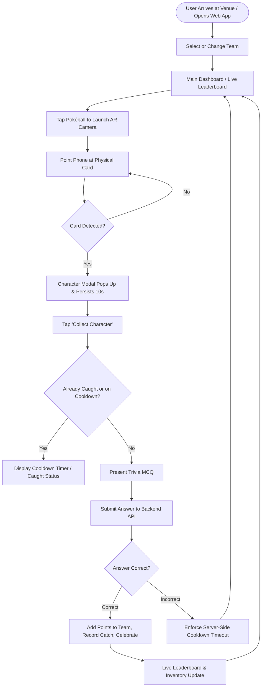

# Product Requirements Document (PRD)

## Project: SiliconQuest — Animeverse AR Scavenger Hunt

---

## 1. Executive Summary

**SiliconQuest** is an interactive, mobile-first Augmented Reality (AR) scavenger hunt web application engineered for the **Animeverse** event, presented by **ACM** in partnership with **Guru Gobind Singh Indraprastha University (GGSIPU EDC Student Chapter)** and **Elysian**.

During the event, teams of participants explore the physical venue searching for 99 uniquely illustrated anime character cards distributed across three distinct rarity tiers. When a team locates a physical card, they scan it using their smartphone camera through the SiliconQuest web application. MindAR’s client-side computer vision engine identifies the exact card in real-time, displays a themed 3D AR HUD overlay, and prompts the team with a trivia challenge. Answering correctly captures the character, grants points based on the card's rarity tier, and dynamically updates the live tournament leaderboard.

---

## 2. Product Vision & Objectives

### 2.1 Vision
Deliver a seamless, high-performance, and visually immersive hybrid physical-digital scavenger hunt experience that runs directly in mobile browsers without requiring native app installations.

### 2.2 Core Objectives
- **Zero-Friction Access:** Fully functional Progressive Web App (PWA) running via WebGL/WebAssembly on standard mobile browsers (Safari on iOS, Chrome on Android).
- **High Detection Accuracy:** Sub-second recognition of 99 physical cards with low false-positive rates and resilience to varied lighting, tilt, and motion blur.
- **Fair & Competitive Gameplay:** Server-authoritative quiz validation and progressive cooldown mechanics to eliminate guessing and brute-force attempts.
- **Dynamic Event Engagement:** Live-updating leaderboard, team switching, inventory tracking, and celebratory audiovisual cues.
- **Robust Hardware Compatibility:** Fault-tolerant webcam stream handling across diverse participant devices (smartphones, tablets, and testing laptops).

---

## 3. Target Audience & Personas

### 3.1 Participant ("The Hunter")
- **Profile:** College student participating in the Animeverse scavenger hunt in a team of 2–4 players.
- **Device:** Personal smartphone (iOS / Android) connected via mobile data or venue Wi-Fi.
- **Needs:** Fast camera startup, instant card recognition, clear quiz prompts, real-time feedback on team score, and transparent leaderboard standings.
- **Pain Points:** Unresponsive cameras, battery drain, lagging interfaces, or cards that refuse to scan.

### 3.2 Game Master / Event Admin
- **Profile:** ACM student coordinator overseeing tournament operations.
- **Needs:** Real-time visibility into registered teams, card catch statuses, manual score adjustments, and one-click database reset capabilities between event rounds.
- **Pain Points:** Hardcoded configurations, database inconsistencies, or manual score tracking errors.

---

## 4. User Journey & Gameplay Loop



---

## 5. Functional Requirements

### 5.1 Team Selection & Management
- **FR-1.1 (Team Roster):** Display all registered teams fetched from the backend database with scores and rankings.
- **FR-1.2 (Persistence):** Store the user's active team selection in `localStorage` so refreshing or re-opening the application maintains team state.
- **FR-1.3 (On-Demand Team Switching):** Users must be able to change teams at any point:
  - From the main dashboard via the prominent **"Change Team"** action.
  - From the interactive leaderboard by tapping any team row.
  - From inside the active AR Camera overlay via the **"Change"** button in the top HUD.
- **FR-1.4 (Search & Filter):** Provide a real-time search input to easily filter and locate specific teams within large rosters.
- **FR-1.5 (Team Uncaught Inventory):** Display a carousel showing which characters the active team has already collected and how many uncaught cards remain available in the venue.

---

### 5.2 Augmented Reality Image Detection
- **FR-2.1 (99-Card Single-Scene Database):** Compile all 99 physical cards into a single target file (`cards.mind`) so the camera never needs to tear down and reload when scanning cards of different tiers.
- **FR-2.2 (Target Mapping):** Map each numerical `targetIndex` in the `.mind` file to its corresponding character record in `client/src/data/targetMap.json`.
- **FR-2.3 (Rarity Tiers & Values):**
  - **Common:** 64 cards (Value: 8 points).
  - **Rare:** 25 cards (Value: 20 points).
  - **Legendary:** 10 cards (Value: 50 points).
- **FR-2.4 (Artwork Optimization):** Target compilation images must be tightly cropped to the artwork rectangle, eliminating white margins, border decorations, name text, and identical corner branding logos to maximize feature distinction and minimize cross-card false matches.
- **FR-2.5 (10-Second Target Loss Persistence):** When a physical card is detected, the card popup overlay must persist on-screen for **10 seconds (10,000ms)** even if the camera moves away, tilts, or temporarily loses visual tracking, giving players sufficient time to interact with the popup.
- **FR-2.6 (Continuous Tracking):** Re-centering the camera on the card within the 10-second window must cancel the dismiss timer and resume continuous tracking seamlessly without UI flicker.

---

### 5.3 Quiz & Anti-Cheat Cooldown Engine
- **FR-3.1 (MCQ Challenge):** Scanning an uncollected card presents a multiple-choice question relevant to the character.
- **FR-3.2 (Server-Side Secrecy):** The correct answer index (`correctAnswer`) must **never** be transmitted to the client in the `/api/cards` payload. Answers are validated strictly server-side in `/api/catch`.
- **FR-3.3 (Duplicate Catch Prevention):** A team cannot collect the same card multiple times. The database schema enforces a unique constraint on `(teamId, cardId)`.
- **FR-3.4 (Progressive Server Cooldown):** Incorrect quiz answers trigger server-enforced cooldowns that scale with subsequent failed attempts, preventing brute-force guessing.
- **FR-3.5 (Cooldown Synchronization):** Active cooldown timers are validated on the server and synchronized with the client HUD to display exact remaining seconds.

---

### 5.4 Camera Hardware Management & Cross-Platform Reliability
- **FR-4.1 (Mobile Camera Preference):** Mobile devices must automatically select the rear/environment camera (`facingMode: { ideal: "environment" }`) at optimal 720p/1080p resolution.
- **FR-4.2 (Desktop / Laptop Fallback):** On desktop or laptop computers (e.g., Windows testing environments), the camera normalizer must avoid `facingMode: environment` to prevent Windows Media Foundation from attempting to open non-color infrared sensors (such as Dell Windows Hello IR cameras).
- **FR-4.3 (Mutex Lock & Hardware Buffer):** Enforce mutual exclusion on `getUserMedia()` requests and insert a minimum 350ms driver release buffer between stopping and starting camera streams to prevent hardware driver deadlocks.
- **FR-4.4 (Automatic Resource Teardown):** Register `beforeunload` and `pagehide` listeners to immediately stop all media tracks when the tab is closed, refreshed, or backgrounded, preventing orphaned hardware locks.
- **FR-4.5 (Graceful Timeout Guard):** Wrap hardware stream acquisition in a 5-second timeout guard to intercept hung driver calls and provide clear, actionable troubleshooting advice ("Camera timed out or in use by another application").

---

### 5.5 Leaderboard & Live Telemetry
- **FR-5.1 (Live Standings):** Display real-time rankings of all teams sorted by total score descending.
- **FR-5.2 (Top-3 Visual Accents):** Specially styled gold, silver, and bronze badges for the top three podium teams.
- **FR-5.3 (Active Team Highlighting):** Automatically highlight the active user's team on the leaderboard with smooth auto-scroll positioning.
- **FR-5.4 (Jittered Polling):** Update leaderboard and caught card counts every ~10s with randomized jitter (±3s) when the AR camera is closed to reduce server query bursts.

---

### 5.6 Admin Portal (Game Master Operations)
- **FR-6.1 (Secure Access):** Hidden modal interface accessible via admin shortcut (`Ctrl+Alt+A` or custom event dispatch) protected by credentials.
- **FR-6.2 (Team Management):** Create new teams, edit team names, or adjust scores manually.
- **FR-6.3 (Card Management):** Inspect all 99 cards, modify questions/options, and monitor caught statistics.
- **FR-6.4 (Round Reset):** One-click nuclear reset button to clear all team catches and cooldowns for new tournament rounds.

---

## 6. Technical Specifications & Architecture

### 6.1 Architecture Overview

```
┌────────────────────────────────────────────────────────┐
│                   Client Browser                       │
│  Next.js 15.5 (App Router) + React 19 + Tailwind v4    │
│                                                        │
│  ┌──────────────────┐        ┌──────────────────────┐  │
│  │   A-Frame 1.5    │        │  cameraStreamHelper  │  │
│  │   MindAR 1.2.5   │        │  • Mutex Lock        │  │
│  │   • cards.mind   │        │  • Mobile/PC Normal  │  │
│  │   • targetMap    │        │  • Teardown on Hide  │  │
│  └────────▲─────────┘        └──────────▲───────────┘  │
│           │                             │              │
│  ┌────────┴─────────────────────────────┴───────────┐  │
│  │                  ARCamera.tsx                    │  │
│  │   • 10s Target Persistence Debounce Timer        │  │
│  │   • Tier Styles & HUD Modals                     │  │
│  └────────────────────────▲─────────────────────────┘  │
└───────────────────────────┼────────────────────────────┘
                            │ HTTPS JSON API
┌───────────────────────────▼────────────────────────────┐
│              Next.js Server API Routes                 │
│  /api/cards  •  /api/catch  •  /api/leaderboard        │
│                                                        │
│  ┌──────────────────────────────────────────────────┐  │
│  │                 Prisma ORM                       │  │
│  └────────────────────────▲─────────────────────────┘  │
└───────────────────────────┼────────────────────────────┘
                            │ PostgreSQL (Port 6543 / 5432)
┌───────────────────────────▼────────────────────────────┐
│              Supabase PostgreSQL Database              │
│       [Card]    [Team]    [Catch]    [Cooldown]        │
└────────────────────────────────────────────────────────┘
```

### 6.2 Data Schema (Prisma)

```prisma
model Card {
  id            String     @id
  name          String
  series        String     @default("")
  value         Int
  tier          String     // "Common" | "Rare" | "Legendary"
  image         String     @default("")
  mindFile      String
  modelUrl      String     @default("")
  question      String
  options       String[]
  correctAnswer Int        // 0-3, kept strictly secret on server
  copies        Int        @default(1)
  caughtCount   Int        @default(0)
  catches       Catch[]
  cooldowns     Cooldown[]
}

model Team {
  id        String     @id
  name      String     @unique
  score     Int        @default(0)
  catches   Catch[]
  cooldowns Cooldown[]
}

model Catch {
  id        String   @id @default(cuid())
  teamId    String
  cardId    String
  createdAt DateTime @default(now())

  team Team @relation(fields: [teamId], references: [id])
  card Card @relation(fields: [cardId], references: [id])

  @@unique([teamId, cardId])
}

model Cooldown {
  teamId      String
  cardId      String
  attempts    Int      @default(0)
  lockedUntil DateTime

  team Team @relation(fields: [teamId], references: [id])
  card Card @relation(fields: [cardId], references: [id])

  @@id([teamId, cardId])
}
```

---

## 7. Non-Functional Requirements

### 7.1 Performance & Frame Rate
- Maintain a minimum of **30–60 FPS** WebGL rendering loop during active camera scanning on mid-tier mobile hardware (iPhone 11+, Snapdragon 7 series+).
- Client bundle size optimized via Next.js dynamic imports (`ssr: false` for A-Frame and MindAR components).

### 7.2 Detection Speed & Accuracy
- Target identification time of `< 800ms` under standard indoor venue lighting.
- Target feature point count target: `> 800` keypoints per card target with high spatial distribution across all 4x4 quadrants.

### 7.3 Fault Tolerance & Recovery
- Graceful recovery from transient camera disconnects or background tab switching via the `cameraStreamHelper` normalizer.
- Friendly error displays with step-by-step resolution prompts (e.g., closing other apps, opening hardware privacy shutters).

---

## 8. Success Metrics

| Metric | Target | Measurement Method |
|---|---|---|
| Average Time to Detect Card | < 1.0s | MindAR controller benchmark & user telemetry |
| False Positive Match Rate | < 0.5% | Feature audit & simulation testing harness |
| Successful Catch Completion Rate | > 90% | Backend catch submissions vs scan events |
| Camera Permission & Startup Success | > 98% | Hardware normalizer error telemetry |
| App First Load Time | < 2.5s | Lighthouse / Web Vitals benchmarks on 4G |

---

## 9. Future Roadmap & Enhancements

- **Phase 2 (Venue Geo-Fencing):** Integrate GPS / BLE beacon validation to ensure participants are physically near specific hunt zones.
- **Phase 3 (3D Character Models):** Render interactive 3D GLTF character models directly on top of cards using A-Frame's animation-mixer.
- **Phase 4 (Live Spectator Mode):** Real-time big-screen projector dashboard visualizing tournament activity and card discoveries as they occur.
